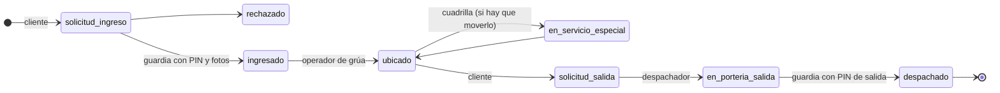

# Mejoras operativas del patio: ingreso, salida, ubicación, estancia y servicios

Fecha: 2026-11-17
Estado: propuesto, decisiones de negocio cerradas; falta conciliar con specs existentes
Versión editable: https://claude.ai/artifact/LFzed55wPtSTrfrUzi713N

## Relación con specs existentes (conciliar antes del plan)

Este spec se escribió a partir de `context.md` (20 sep 2026). El repo ya tiene specs
posteriores que se empalman con él:

- **Migraciones.** `0011_patio_punto_entrada` ya existe. La numeración `0011` a `0015` de
  este spec se debe recorrer a partir de la última migración real.
- **Roles.** Ya existen `operador` y `supervisor` (`_ROLES_ESCRITURA`). Hay que decidir si
  `operador_grua` es un rol nuevo o el `operador` existente con otro nombre en la interfaz.
- **Mapa y ubicación (Fase 2).** `2026-09-22-mapa-patio-design.md` ya define `/mapa`,
  `GET /api/patios/{id}/mapa`, `GET /api/tiras/{id}`, el panel de pendientes y la
  colocación con `POST /api/movimientos`. La Fase 2 debe extender ese diseño, no
  redefinirlo. Ver `2026-11-17-ubicacion-contenedores-design.md`.
- **Reportes (Fase 3).** `2026-09-30-modulo-reportes-design.md` y
  `2026-10-22-reportes-cliente-design.md` ya definen `/reportes`, cinco reportes con
  Excel institucional, envíos programados y acceso del cliente. La estancia se agrega como
  reportes nuevos de ese módulo. Ver `2026-11-17-reporte-estancia-design.md`.
- **Servicios (Fase 4).** El reporte `SPECIAL-SERVICES` lee hoy `Movimiento.tipo ==
  'servicio'`. Con este spec debe leer `servicios_contenedor`.

## Resumen y objetivos

El patio debe saber en todo momento dónde está cada contenedor, cuánto tiempo lleva y qué
se le hizo. Este spec lo resuelve en cuatro fases. La Fase 1 va primero porque cierra el
ciclo de ingreso y salida, que hoy está incompleto: no existe la transición a `despachado`
y nada impide sacar un contenedor que no está en patio.

| # | Objetivo | Meta propuesta | Fase |
| --- | --- | --- | --- |
| 1 | Ingreso rápido | El guardia registra una entrada desde el celular en menos de 60 s, sin escribir UUIDs | 1A |
| 2 | Salida solo de contenedores en patio | El backend rechaza toda salida de un contenedor que no esté ubicado en ese patio | 1B |
| 3 | Ubicación | Cualquier usuario interno encuentra un contenedor por número y ve carril, tramo, tira y nivel | 2 |
| 4 | Estancia por día | Reporte de días de estancia por contenedor y por cliente, exportable a Excel | 3 |
| 5 | Servicios especiales | Cada servicio queda ligado a un contenedor, con fecha, responsable y evidencia | 4 |

La mejora de experiencia para usuarios internos y externos atraviesa las cuatro fases y
depende de terminar los componentes `components/ui/` del rediseño en curso.

Specs detallados de las fases siguientes:

- Fase 2: `2026-11-17-ubicacion-contenedores-design.md`
- Fase 3: `2026-11-17-reporte-estancia-design.md`
- Fase 4: `2026-11-17-servicios-especiales-design.md`
- Transversal: `2026-11-17-experiencia-usuario-portal-design.md`

## Estado actual

La base es sólida: jerarquía de ubicaciones, locking de slot, PIN de entrada, auditoría y
RLS por patio ya existen. Lo que falta son las reglas y pantallas que conectan esas piezas
en la operación diaria.

| Objetivo | Lo que ya existe | Hueco que lo impide |
| --- | --- | --- |
| Ingreso rápido | `POST /contenedores/verificar-pin`, página `/porteria`, `POST /movimientos` tipo ingreso, sugerencia de ubicación | Verificar el PIN y registrar el ingreso son dos pasos separados. El movimiento pide UUIDs escritos a mano. El rol `guardia` no puede escribir. No hay límite de intentos de PIN. |
| Salida validada | `POST /contenedores/{id}/solicitar-salida`, cola de grúa en `/salidas` | No existe la transición `solicitud_salida → despachado`. No hay unicidad de `numero_contenedor` en activos. El rol `despachador` no puede escribir. |
| Ubicación | Patio, carril, tramo, tira y nivel; `POST /ubicaciones/sugerir` | No hay buscador. Los formularios no tienen selector de contenedor ni de ubicación. |
| Estancia por día | Movimientos con fecha y auditoría | No hay reporte de estancia, ni corte diario, ni días libres por cliente. `en_estadia` no lo asigna nadie. |
| Servicios especiales | Tipo de movimiento "servicio" y estado `en_servicio_especial` | No hay catálogo de servicios ni registro de qué se hizo, quién y cuándo. |

## Ciclo de vida propuesto

Solo un contenedor listo en puerta puede despacharse. Desde cualquier otro estado, la
salida se rechaza con 409 y el motivo en palabras. El ciclo usa estados que ya están
declarados en el enum y deja `en_estadia` como cálculo.

## Fase 1A — Ingreso rápido en portería

El ingreso pasa de dos pasos sueltos a una sola pantalla móvil: el guardia captura el PIN,
confirma y el contenedor queda `ingresado` con su ubicación sugerida. Los datos ya vienen
de la solicitud del cliente, así que en portería solo se captura lo que se ve en la puerta.

### Flujo

1. El cliente solicita la entrada (ya existe). Estado `solicitud_ingreso`, PIN enviado por correo.
2. El guardia abre **Portería → Ingreso** y teclea el PIN o el número de contenedor. El
   número se valida con ISO 6346 mientras se escribe y se pone en mayúsculas solo.
3. Aparece la tarjeta de la solicitud: número, cliente, tamaño y tipo, lleno o vacío. El
   guardia captura placas, operador, sellos, la inspección rápida (sin daños, o daños con
   nota) y las fotos del contenedor, que son obligatorias aunque no haya daños.
4. **Confirmar ingreso** crea el movimiento de ingreso y pasa el contenedor a `ingresado`.
   La respuesta trae las tres mejores ubicaciones del algoritmo de sugerencia.
5. El operador de grúa ve el contenedor en su lista **Por ubicar** y confirma la ubicación
   sugerida con un toque, o elige otra. El contenedor pasa a `ubicado`.

Un contenedor que llega sin solicitud se puede dar de alta en portería solo con rol
supervisor o admin, con cliente obligatorio, y queda marcado como "sin solicitud".

### API

| Método | Ruta | Qué hace |
| --- | --- | --- |
| GET | `/api/porteria/buscar?q=` | Busca solicitudes pendientes del patio por PIN o número parcial |
| POST | `/api/porteria/ingresos` | En una transacción: valida PIN y estado, crea el movimiento de ingreso, guarda la inspección y las fotos, cambia a `ingresado` y devuelve 3 sugerencias de ubicación |
| POST | `/api/contenedores/{id}/ubicar` | Asigna ubicación con el locking de slot existente y cambia a `ubicado` |

### Reglas que se agregan

- `POST /movimientos` de tipo ingreso exige PIN verificado o alta "sin solicitud" por
  supervisor. Cierra el hueco de la Spec 2.
- Después de 5 PIN incorrectos para un contenedor, se bloquea 15 minutos y queda en
  auditoría (valores propuestos).
- Índice único parcial sobre `numero_contenedor` donde el estado no es `despachado` ni
  `rechazado`. Un mismo número no puede estar dos veces activo.
- Un ingreso sin al menos una foto responde 422.
- `require_roles` acepta `guardia` en las rutas de portería, solo para su patio.
- Rol nuevo `operador_grua` en `RolUsuario`: confirma ubicaciones
  (`POST /contenedores/{id}/ubicar`) y reubica, solo en su patio.

### Datos

Tabla `inspecciones` (movimiento_id, placas, operador, sellos, daños en jsonb, notas) y
tabla `evidencias` (contenedor_id, movimiento_id, servicio_contenedor_id opcional, url,
tipo, creado_por). Las fotos van a DigitalOcean Spaces y cada ingreso guarda al menos una.
`evidencias` se reutiliza en la Fase 4.

### Pantalla

Una sola columna, botones de al menos 48 px, teclado numérico para el PIN y alto contraste
para uso a pleno sol. Cada resultado da respuesta inmediata: verde con el siguiente paso, o
rojo con el motivo en palabras ("El PIN no corresponde a ninguna solicitud de este patio").

## Fase 1B — Salida validada

Un contenedor solo sale si el sistema lo tiene ubicado en ese patio. La regla vive en el
backend, dentro de la misma transacción que registra la salida, y la pantalla solo muestra
contenedores que la cumplen.

### Regla de despacho

La salida se acepta solo si se cumplen todas estas condiciones:

- El contenedor pertenece al patio del usuario (RLS más validación explícita).
- Su estado es `en_porteria_salida`, o `ubicado` / `solicitud_salida` en una salida
  directa autorizada por supervisor.
- Tiene una ubicación actual registrada.
- No tiene un servicio especial pendiente (Fase 4: los cuatro servicios bloquean).
- El PIN de salida coincide.

El contenedor se bloquea con `SELECT … FOR UPDATE` al inicio, así dos guardias no pueden
despachar el mismo contenedor al mismo tiempo. Si una condición falla, la API responde 409
con el motivo en palabras: "MSCU1234565 no está en este patio" o "Tiene un traspaleo
pendiente".

### Bloqueo administrativo (construido y apagado)

Por ahora un adeudo o una retención aduanal no impiden la salida. Todo queda construido
para activarlo con un interruptor por patio, sin otro desarrollo.

- Tabla `bloqueos`: contenedor_id, tipo (`adeudo`, `retencion_aduanal`, `otro`), motivo,
  creado_por, creado_en, liberado_por, liberado_en.
- Columna `patios.bloqueos_activos`, en falso por defecto.
- **Apagado**: los bloqueos se registran y aparecen como aviso en `/salidas` y en portería,
  pero no detienen el despacho.
- **Encendido**: la regla de despacho rechaza la salida si hay un bloqueo sin liberar, con
  409 "Tiene una retención aduanal sin liberar".
- Endpoints `POST /api/contenedores/{id}/bloqueos` y `POST /api/bloqueos/{id}/liberar`,
  solo admin. Las pruebas cubren los dos modos desde el inicio.

### Flujo

1. El cliente solicita la salida (ya existe). Ahora también se genera un **PIN de salida**
   y se manda al cliente para su transportista. Es el mismo enfoque que la Spec 2 y
   sustituye al QR de salida mientras no exista.
2. El despachador ve la cola del día en `/salidas`, ordenada por fecha deseada y remanejos
   necesarios. Cuando la grúa baja el contenedor, marca **Listo en puerta** y el estado
   pasa a `en_porteria_salida`.
3. El guardia abre **Portería → Salida**, captura el PIN de salida, placas, operador y
   sello, y confirma.
4. En una transacción: movimiento de salida, se libera la ubicación, el estado pasa a
   `despachado` y se cierra la estancia con `fecha_salida`.

### API

| Método | Ruta | Qué hace |
| --- | --- | --- |
| POST | `/api/salidas/{id}/listo` | Despachador marca el contenedor listo en puerta |
| POST | `/api/porteria/salidas` | Valida la regla de despacho y registra la salida |
| POST | `/api/salidas/{id}/cancelar` | Cancela o reprograma una solicitud (hueco ya registrado) |

### Cambios de datos y roles

- Columnas `pin_salida_hash`, `pin_salida_intentos` y `fecha_salida` en `contenedores`,
  con el mismo límite de intentos que el PIN de entrada.
- `CHECK`: un contenedor `despachado` no puede tener ubicación actual.
- `require_roles` acepta `despachador` en `/salidas` y `guardia` en `/porteria/salidas`.
- La pantalla de salida en portería no ofrece un campo libre: solo busca entre
  contenedores `en_porteria_salida` del patio.

## Fase 2 — Ubicación

Resumen; el detalle está en `2026-11-17-ubicacion-contenedores-design.md`, que debe
extender `2026-09-22-mapa-patio-design.md`.

- **Buscador global** en la barra superior (Ctrl+K): con cuatro caracteres del número
  muestra la ubicación en palabras, el cliente, el estado y los días en patio.
- **Selectores** `ContenedorPicker` y `UbicacionPicker` que reemplazan todos los campos de UUID.
- **Mapa**: modos de color por cliente, días de estancia, lleno o vacío y servicio pendiente.
- **Remanejos**: cuántos contenedores tiene encima cada uno; ordena la cola de despacho.

## Fase 3 — Reporte de estancia por día

Resumen; el detalle está en `2026-11-17-reporte-estancia-design.md`, que se agrega al
módulo de `2026-09-30-modulo-reportes-design.md`.

- **Estancia**: de la hora del movimiento de ingreso a la de salida, o hasta ahora.
- **Días de estancia**: días calendario en hora de Ciudad de México. El día de ingreso
  cuenta como día 1.
- **Días libres**: pactados por cliente en `clientes.dias_libres`. Días cobrables = máximo
  entre 0 y (días de estancia menos días libres).
- `en_estadia` deja de ser un estado: la estancia es un cálculo.
- **Corte diario** en `inventario_diario`, idempotente, desde `background-jobs`.

## Fase 4 — Servicios especiales

Resumen; el detalle está en `2026-11-17-servicios-especiales-design.md`.

- `servicios_catalogo` con el catálogo inicial: traspaleo, reacomodo, desempalme y
  empalme. Los cuatro bloquean la salida, traspaleo y reacomodo piden fotos y el traspaleo
  registra una segunda unidad (contenedor o caja seca).
- `servicios_contenedor`: la orden, con estados `solicitado`, `programado`, `en_proceso`,
  `terminado`, `rechazado`, `cancelado`.
- Los servicios los hace una cuadrilla, con el rol nuevo `cuadrilla`.

## Experiencia de usuario

Resumen; el detalle está en `2026-11-17-experiencia-usuario-portal-design.md`.

| Rol | Pantalla de inicio | Acciones principales | Dispositivo |
| --- | --- | --- | --- |
| Guardia | Portería | Ingreso, salida, búsqueda | Celular |
| Despachador | Salidas del día | Marcar listo en puerta, reprogramar | Celular o tableta |
| Operador de grúa | Por ubicar | Confirmar ubicación, reubicar | Celular |
| Cuadrilla | Servicios de hoy | Iniciar y terminar servicios, subir fotos | Celular |
| Admin | Tablero | Ocupación, entradas y salidas de hoy, servicios pendientes, reportes | Escritorio |

## Migraciones, pruebas y pendientes

### Migraciones

Numeración tentativa: recorrer a partir de la última migración real del repo.

| Migración | Contenido | Fase |
| --- | --- | --- |
| A | Índice único parcial de `numero_contenedor`, intentos de PIN, columnas de PIN de salida y `fecha_salida`, `CHECK` de despachado sin ubicación, valores `operador_grua` y `cuadrilla` en `RolUsuario` | 1 |
| B | Tablas `inspecciones` y `evidencias` con RLS por patio | 1 |
| C | Tabla `bloqueos` y `patios.bloqueos_activos` en falso | 1 |
| D | `clientes.dias_libres` y tabla `inventario_diario` | 3 |
| E | `servicios_catalogo` con traspaleo, reacomodo, desempalme y empalme; `servicios_contenedor` con columnas de segunda unidad; RLS por patio | 4 |

### Pruebas que guían la Fase 1 (TDD)

- Ingreso con PIN correcto y fotos: crea movimiento, estado `ingresado`, devuelve 3 sugerencias.
- Ingreso sin fotos: 422.
- Sexto PIN incorrecto: 423 y el contenedor queda bloqueado.
- Dos ingresos activos con el mismo número: 409.
- Un guardia intenta confirmar una ubicación: 403. El operador de grúa del mismo patio: pasa.
- Salida de un contenedor `solicitud_ingreso` o sin ubicación: 409 con motivo.
- Salida de un contenedor de otro patio: 404, sin revelar que existe.
- Dos salidas simultáneas del mismo contenedor: solo una se registra.
- Salida con un bloqueo sin liberar y `bloqueos_activos` en falso: pasa y la respuesta trae
  el aviso. En verdadero: 409 hasta liberarlo.
- Salida exitosa: ubicación liberada, estado `despachado`, `fecha_salida` asignada.
- Guardia sin patio asignado: 403 en portería.

### Fuera de alcance

QR firmado, PWA sin conexión, arrastrar y soltar en el mapa, API de socios y facturación.
El PIN de salida y los selectores cubren la necesidad mientras tanto.

### Decisiones tomadas (17 nov 2026)

| Pregunta | Decisión |
| --- | --- |
| Día de ingreso y días libres | El día de ingreso cuenta como día 1. Los días libres se pactan por cliente. |
| Quién confirma la ubicación | El operador de grúa. Se crea el rol `operador_grua`. |
| Fotos en el ingreso | Obligatorias, aunque no haya daños. |
| Adeudo o retención aduanal | Hoy no bloquean la salida. El bloqueo queda construido y apagado, listo para activarse por patio. |
| Catálogo de servicios | Traspaleo, reacomodo, desempalme y empalme. |
| Servicios que bloquean la salida | Los cuatro, mientras no se terminan. |
| Fotos en servicios | Obligatorias en traspaleo y reacomodo. |
| Segunda unidad | Solo el traspaleo: un contenedor o una caja seca. |
| Quién hace los servicios | Una cuadrilla, con el rol nuevo `cuadrilla`. |

### Preguntas abiertas

- [ ] ¿Alguno de los cuatro servicios obliga a llevar el contenedor a otra zona del patio?
- [ ] ¿`operador_grua` es un rol nuevo o el `operador` que ya existe?
