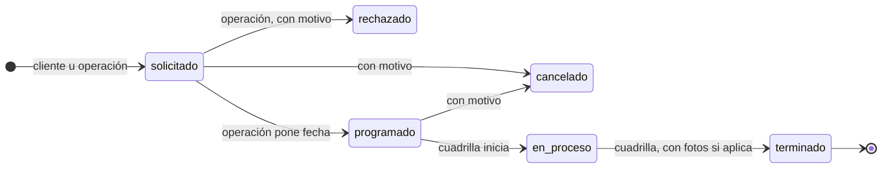

# Servicios especiales a contenedores

Fecha: 2026-11-17
Estado: propuesto, catálogo y reglas de negocio decididos
Versión editable: https://claude.ai/artifact/WamKNPuW4P4bqVoMWvHoKm

## Relación con specs existentes

- **Reporte `SPECIAL-SERVICES`** (`2026-09-30-modulo-reportes-design.md`) lee hoy
  `Movimiento.tipo == 'servicio'` y sus ejemplos son lavado, conexión reefer e inspección.
  Con este spec pasa a leer `servicios_contenedor` (órdenes `terminado`), con
  `Cantidad = 1` y `Unidad = SERVICIO`. Se agrega la columna de segunda unidad para el
  traspaleo.
- **Roles**: el módulo de reportes y el mapa usan `operador`, `supervisor` y `admin`.
  `cuadrilla` es un rol nuevo; "operación" en este spec equivale a `supervisor`.
- **Migraciones**: numerar a partir de la última migración real del repo.

## Resumen

Cada servicio especial se registra como una orden ligada a un contenedor: qué se hizo,
quién lo pidió, quién lo hizo, cuándo y con qué evidencia. Un servicio pendiente impide
que el contenedor salga hasta que se termina. Corresponde a la Fase 4 de
`2026-11-17-mejoras-operativas-patio-design.md`.

Hoy existen el tipo de movimiento "servicio" y el estado `en_servicio_especial`, pero no
hay catálogo ni órdenes. Este spec les da uso sin agregar estados nuevos al contenedor.

| Meta | Cómo se mide |
| --- | --- |
| Trazabilidad | Cada servicio terminado tiene contenedor, responsable, fechas y, si el catálogo lo pide, fotos |
| Sin salidas indebidas | Ningún contenedor con servicio pendiente pasa la portería de salida |
| Autoservicio del cliente | El cliente solicita y sigue sus servicios desde el portal |
| Base para cobrar | Reporte de servicios terminados por cliente y periodo, exportable |

## Ciclo de una orden de servicio

Mientras la orden está en `solicitado`, `programado` o `en_proceso`, el contenedor no
puede salir. Solo se puede rechazar en `solicitado` y cancelar antes de iniciarse.

## Modelo de datos y reglas

Tres tablas: el catálogo dice qué servicios existen y cómo se comportan; la orden registra
cada servicio a un contenedor; las evidencias guardan las fotos. Las tres tienen RLS por
patio y cada cambio va a auditoría.

### `servicios_catalogo`

| Columna | Tipo | Uso |
| --- | --- | --- |
| `codigo` | texto, único por patio | Clave corta: `TRA`, `REA`, `DES`, `EMP` |
| `nombre`, `descripcion` | texto | Lo que ve el cliente |
| `patio_id` | uuid, nulo | Nulo: disponible en todos los patios |
| `requiere_evidencia` | booleano | Pide fotos al terminar |
| `bloquea_salida` | booleano | Impide el despacho mientras esté pendiente |
| `requiere_mover` | booleano | Hay que llevar el contenedor a la zona de servicio |
| `requiere_unidad_relacionada` | booleano | Pide registrar una segunda unidad (contenedor o caja seca) |
| `cliente_puede_solicitar` | booleano | Aparece en el portal |
| `activo` | booleano | Se desactiva, nunca se borra |

**Catálogo inicial** (decidido el 17 nov 2026). La migración lo da de alta para todos los patios:

| Código | Servicio | Bloquea salida | Pide fotos | Segunda unidad |
| --- | --- | --- | --- | --- |
| `TRA` | Traspaleo | Sí | Sí | Sí: contenedor o caja seca |
| `REA` | Reacomodo | Sí | Sí | No |
| `DES` | Desempalme | Sí | No | No |
| `EMP` | Empalme | Sí | No | No |

`requiere_mover` queda en falso para los cuatro hasta confirmar si alguno se hace fuera de
la tira del contenedor. En desempalme y empalme se pueden subir fotos aunque no sean
obligatorias.

### `servicios_contenedor` (la orden)

Contenedor, servicio, cliente, estado, `solicitado_por`, `asignado_a`, `realizado_por`,
`programado_para`, `solicitado_en`, `iniciado_en`, `terminado_en`, notas y `motivo` (para
rechazo o cancelación). Estados: `solicitado`, `programado`, `en_proceso`, `terminado`,
`rechazado`, `cancelado`.

**Segunda unidad (solo traspaleo).** La orden agrega `unidad_relacionada_tipo`
(`contenedor` o `caja_seca`), `contenedor_relacionado_id` (si es un contenedor registrado
en el patio) y `unidad_relacionada_ref` (número de la caja seca o del contenedor externo, y
placas). Son obligatorias cuando el servicio tiene `requiere_unidad_relacionada`; para los
demás servicios quedan vacías.

### `evidencias`

La misma tabla que crea la Fase 1A, con `servicio_contenedor_id` y un `momento` (`antes` o
`despues`). Las fotos se suben directo a DigitalOcean Spaces con una URL firmada.

### Reglas

1. **Cuándo se puede pedir**: con el contenedor en `solicitud_ingreso`, `ingresado`,
   `ubicado` o `solicitud_salida`. Pedido antes del ingreso, el servicio solo se puede
   iniciar cuando el contenedor ya está `ubicado`.
2. **Efecto en el contenedor**: si el servicio tiene `requiere_mover`, al iniciarlo se
   registra un movimiento tipo servicio hacia la zona de servicio y el contenedor pasa a
   `en_servicio_especial`. Al terminar se reubica con `UbicacionPicker` y vuelve a
   `ubicado`. Si no requiere moverlo, el estado del contenedor no cambia.
3. **Varias órdenes a la vez**: el contenedor sigue `en_servicio_especial` mientras tenga
   alguna orden `en_proceso` que requiera moverlo.
4. **Bloqueo de salida**: la regla de despacho de la Fase 1B rechaza la salida si existe
   una orden `bloquea_salida` en `solicitado`, `programado` o `en_proceso`. La solicitud de
   salida sí se permite, con un aviso al cliente.
5. **Evidencia**: si el catálogo la exige, terminar sin al menos una foto `despues` responde 422.
6. **Cancelar**: el cliente cancela solo sus órdenes en `solicitado`; operación cancela en
   `solicitado` o `programado`, siempre con motivo.

## API, permisos y pantallas

Cada cambio de estado de una orden es su propio endpoint, así cada uno valida sus reglas y
queda claro en auditoría quién hizo qué.

| Método | Ruta | Quién |
| --- | --- | --- |
| GET, POST | `/api/servicios/catalogo` | Leer: todos (el cliente solo ve los que puede solicitar). Crear: admin |
| PATCH | `/api/servicios/catalogo/{id}` | Admin |
| POST | `/api/contenedores/{id}/servicios` | Cliente (sus contenedores), operación, admin |
| GET | `/api/servicios?estado=&cliente_id=&desde=&hasta=` | Internos; cliente solo los suyos |
| POST | `/api/servicios/{id}/programar` | Operación, admin. Body: `programado_para`, `asignado_a` |
| POST | `/api/servicios/{id}/iniciar` | Cuadrilla, operación |
| POST | `/api/servicios/{id}/terminar` | Cuadrilla, operación. Body: notas, ubicación de regreso si se movió |
| POST | `/api/servicios/{id}/rechazar` y `/cancelar` | Según la regla 6, con motivo |
| POST | `/api/evidencias/firma` | Devuelve una URL firmada de Spaces para subir una foto |
| POST | `/api/evidencias` | Registra la foto subida y la liga a la orden |

El reporte de servicios por cliente y periodo es el `SPECIAL-SERVICES` existente, leyendo
`servicios_contenedor`.

**Rol nuevo `cuadrilla`** (decidido el 17 nov 2026): los servicios los hace una cuadrilla,
no el operador de grúa. La cuadrilla inicia y termina órdenes, sube fotos y captura la
segunda unidad del traspaleo, solo en su patio. Su pantalla de inicio es **Servicios de hoy**.

### Pantallas internas

- **Servicios** (`/servicios`): tabla de órdenes con filtros por estado, cliente y fecha.
  Vista **Hoy** por defecto, agrupada en Por programar, Programados, En proceso y
  Terminados hoy.
- **Orden en el celular**: botones grandes **Iniciar** y **Terminar**, cámara para fotos
  antes y después, captura de la segunda unidad en el traspaleo y el selector de ubicación
  de regreso cuando aplica.
- **Detalle del contenedor**: pestaña Servicios con el historial y sus fotos.
- **Catálogo** (`/servicios/catalogo`, admin): alta, edición y desactivación.
- **Mapa**: el modo "Servicio" marca las tiras con órdenes pendientes.

### Portal del cliente

- Botón **Solicitar servicio** en cada contenedor, con la lista de servicios que puede
  pedir y un campo de notas.
- Estado de cada orden en la línea de tiempo del contenedor.
- Correos: orden programada (con fecha), orden terminada (con enlace a las fotos), orden
  rechazada (con motivo).
- Aviso en la tarjeta: "Este contenedor no puede salir hasta terminar: Traspaleo".

## Pruebas (TDD)

- Despachar un contenedor con un traspaleo `programado`: 409 con el nombre del servicio.
- El mismo contenedor después de terminar el traspaleo: la salida pasa.
- Cada uno de los cuatro servicios del catálogo, pendiente, impide la salida.
- Iniciar un servicio con `requiere_mover`: movimiento tipo servicio y estado
  `en_servicio_especial`. Terminarlo: vuelve a `ubicado` en la ubicación indicada.
- Iniciar un servicio de un contenedor en `solicitud_ingreso`: 409.
- Terminar un traspaleo o un reacomodo sin foto: 422. Terminar un desempalme sin foto: pasa.
- Crear un traspaleo sin segunda unidad: 422. Con caja seca y su número: pasa. Con un
  contenedor del patio: queda ligado por `contenedor_relacionado_id`.
- El operador de grúa intenta iniciar un servicio: 403. La cuadrilla del mismo patio: pasa.
- El cliente cancela una orden `programado`: 403. Una `solicitado`: se cancela.
- El cliente solicita un servicio con `cliente_puede_solicitar` en falso: 403.
- El cliente pide servicio para un contenedor de otra empresa: 404.
- `SPECIAL-SERVICES` lista solo órdenes `terminado`.

## Fuera de alcance

Precios y facturación, proveedores externos que hacen el servicio, cotizaciones con
aprobación del cliente y checklists por tipo de servicio.

## Preguntas abiertas

- [ ] ¿Alguno de los cuatro servicios obliga a llevar el contenedor a otra zona del patio?
  Hoy `requiere_mover` queda en falso para todos.
- [ ] Si hay una zona de servicio física, se modela como un carril marcado como zona de servicio.
